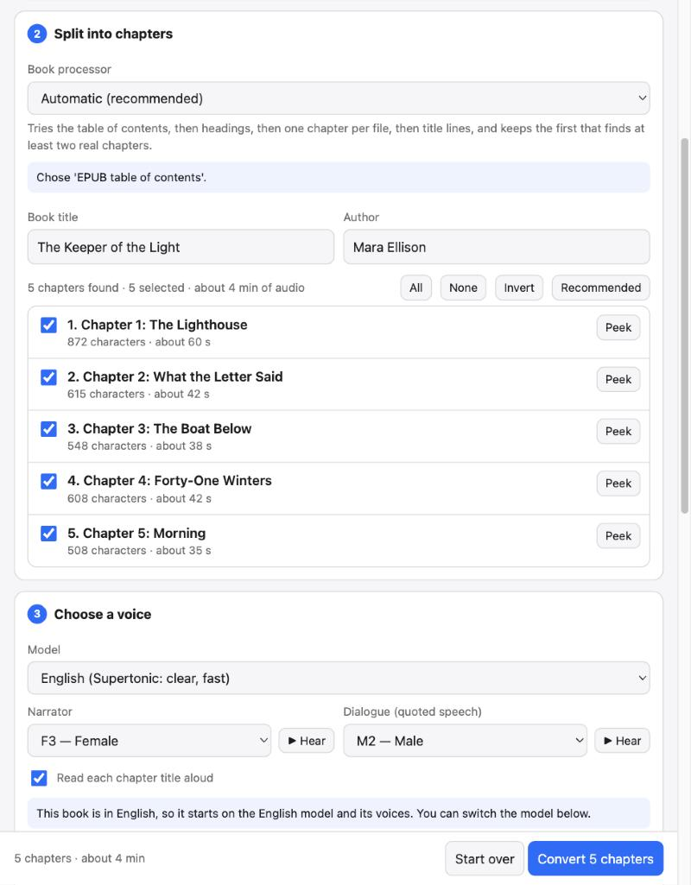
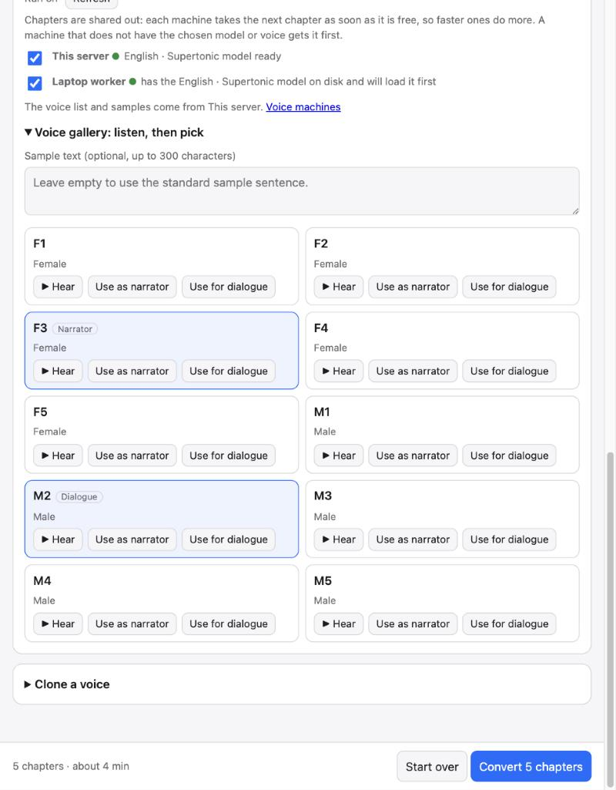
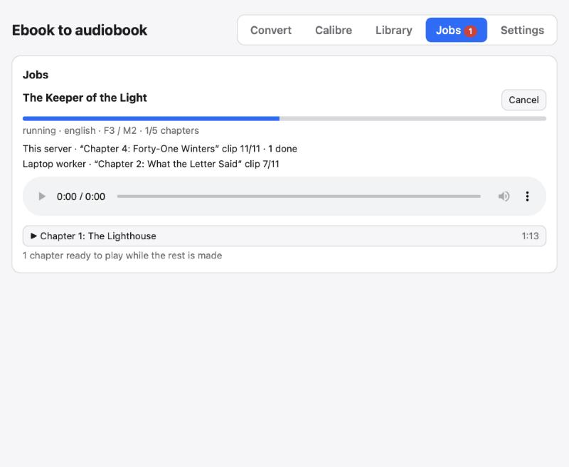
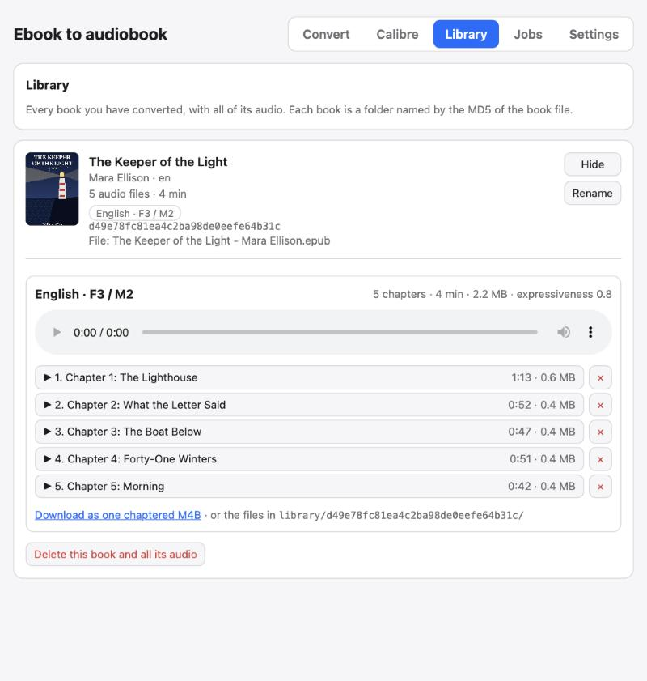
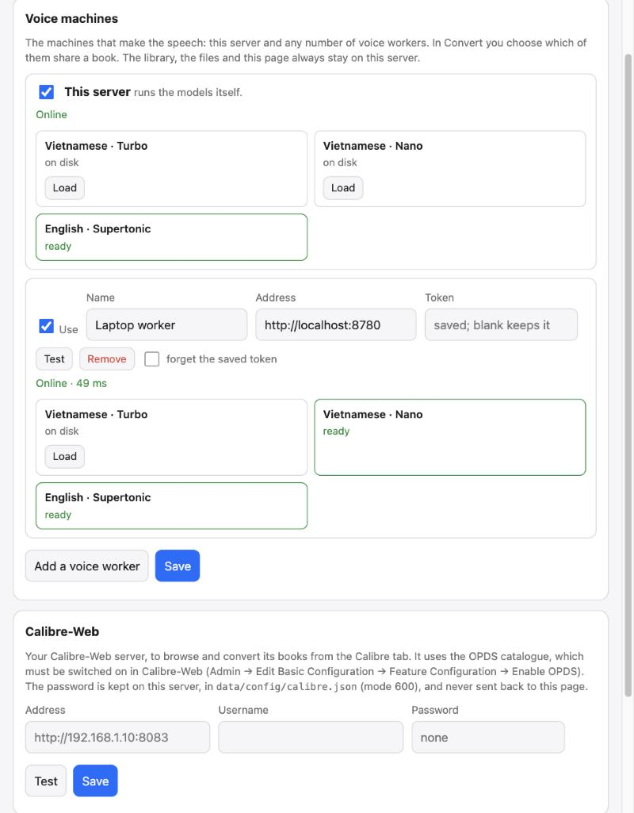
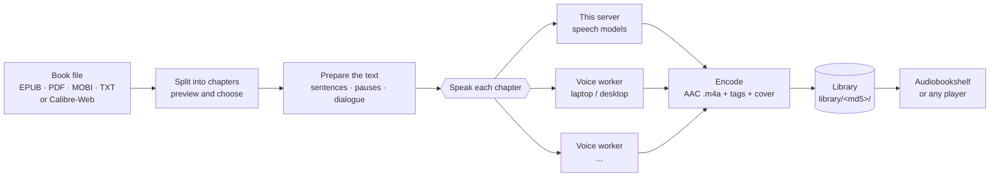

# ebook2audio

**Turn your ebooks into audiobooks on your own hardware.** Upload an EPUB, PDF or text file (or pick a book from your
Calibre-Web library), check how it was split into chapters, choose a voice, and get one audio file per chapter in a
library that Audiobookshelf or any player can read. No cloud, no account, nothing leaves your network except the
one-time model downloads.

Vietnamese and English books are supported. The speech can be made on the machine that runs the service, on other
computers you add as **voice workers**, or on all of them at once, sharing each book between them.

<p align="center">
  
  &nbsp;
  
</p>

## What it does

- **Splits books properly.** Six chapter-splitting methods (the book's own table of contents, headings, one chapter per
  file, title lines, equal parts, or automatic) with a **preview before anything is converted**: sizes, estimated
  length, and the first and last words of every chapter. You choose which chapters to make.
- **Natural reading.** Sentence-aware pauses, abbreviations that don't end a sentence (`Dr.`, `a.m.`, `e.g.`), optional
  chapter titles, and a **second voice for quoted speech**.
- **Vietnamese and English.** Two Vietnamese models (Nano for speed, Turbo for quality) and a separate English model.
  Upload an English book and the page switches to the English model and its ten voices by itself.
- **Hear before you commit.** A voice gallery with samples, on your own sample text if you like. Voice cloning from a
  short recording for the Vietnamese models.
- **A real library.** One folder per book, named by the MD5 of the file, holding tagged `.m4a` chapters, the cover and a
  manifest. Chapters are playable while the rest is still being made, a stopped job resumes where it left off, and
  one click builds a single chaptered **M4B**.
- **Share the work across machines.** Add laptops, desktops or a second server as voice workers. Each takes the next
  free chapter, so faster machines do more. A worker **chooses its own models and device** (a GPU for the models
  that can use one, the CPU for the rest) and downloads what it serves itself; a worker that fails is dropped
  without stopping the book.
- **Calibre-Web built in.** Browse your Calibre-Web library from the page, preview a book there, and send it straight
  into Convert, with Calibre-Web's own cover.
- **Runs in Docker or directly.** Two images (server and worker), and the service starts with no model loaded. An
  NVIDIA GPU image (about 5 GB) and a `--device` flag let a worker use a GPU, with a start-up check and a
  fall-back to the CPU (not yet run on real GPU hardware).

## Screenshots

| Jobs: two machines working on one book | Library: tagged chapters, cover, M4B download |
|---|---|
|  |  |

<p align="center">
  
</p>

## How it works



## Quick start

You need Docker, or Python 3.12 with `ffmpeg`. About 1 to 2 GB of disk is used by the models, which download the first
time each one is used.

```bash
git clone <this repository>
cd <repository>/nas-audiobook
docker compose up -d --build
```

Open **http://localhost:8765**, upload a book, and follow the three steps. The very first conversion starts slowly
while its model downloads (about 280 MB for the Vietnamese Nano model, 390 MB for English).

Without Docker:

```bash
cd nas-audiobook
python3.12 -m venv .venv && . .venv/bin/activate
pip install -r requirements.txt -r requirements-mac-cpu.txt   # an NVIDIA GPU: requirements-nvidia-gpu.txt
DATA_DIR=./data python -m app
```

Everything is stored under `DATA_DIR`. Details, options and the other ways in (a drop folder, a quick API for scripts,
Calibre-Web) are in the [getting started guide](docs/getting-started.md).

### Add a voice worker

On a second machine:

```bash
cd nas-audiobook
cp .env.example .env        # set WORKER_TOKEN to a secret
docker compose -f docker-compose.worker.yml up -d --build
```

Then add `http://<that machine>:8780` and the token under **Settings → Voice machines**. In Convert, tick the machines
that should share the book. See [Voice workers](docs/workers.md).

## Models

| Model | Language | Output | Notes |
|---|---|---|---|
| Vietnamese Nano | Vietnamese | 24 kHz | Fast and light; voice cloning |
| Vietnamese Turbo | Vietnamese | 48 kHz | Best Vietnamese quality, about 3x slower; voice cloning |
| English (Supertonic) | English | 44.1 kHz | Ten voices; clear and fast |

The Vietnamese models are [VieNeu](https://github.com/pnnbao97/VieNeu-TTS); the English model is
[Supertonic](https://github.com/supertone-inc/supertonic). On the same ten English sentences, a speech recogniser
heard 1.7% word errors from the English model against 7.6% for Turbo and 20.2% for Nano, which is why English books
get their own model. See [Models and voices](docs/voices-and-models.md) for the caveats of that test.

## Supported books

EPUB, PDF with a text layer, plain text and Markdown work out of the box. MOBI, AZW/AZW3, FB2, DOCX, RTF and others
work through Calibre's `ebook-convert` (included in the server image). Scanned PDFs need OCR first. Books must be
DRM-free.

## Documentation

| | |
|---|---|
| [Overview](docs/overview.md) | The ideas and the parts |
| [Getting started](docs/getting-started.md) | Install, first book, Audiobookshelf |
| [User guide](docs/user-guide.md) | The page, tab by tab |
| [Book processing](docs/book-processing.md) | Splitting methods and text preparation |
| [Models and voices](docs/voices-and-models.md) | Models, voices, cloning, English |
| [The library](docs/library.md) | Folders, file names, tags, M4B |
| [Voice workers](docs/workers.md) | Sharing a book, worker-owned models, protocol |
| [Calibre-Web](docs/calibre-web.md) | Browse, preview, import |
| [Configuration](docs/configuration.md) | Every setting and file |
| [HTTP API](docs/api.md) | Server and worker endpoints |
| [Architecture](docs/architecture.md) | How jobs and machines work |
| [Development](docs/development.md) | Tests, extending |
| [Operations](docs/operations.md) | Backups, upgrades, troubleshooting, security |
| [Phone worker](docs/phone-worker.md) | An experiment with a phone as a worker |

## Project layout

```
nas-audiobook/    the service (Python, FastAPI, one-file web page), Dockerfiles, tests, tools
android-spike/    a Kotlin experiment: the Nano model on an Android phone
docs/             documentation
```

## Status and honest limits

Built and tested: the whole flow, the chapter splitters on a real EPUB, three models, voice workers (including
failure during a book and on-demand downloads), Calibre-Web browsing and import against a real instance, and both
Docker images running together. The test suite has 291 tests, with fake speech so it needs no models.

Not done or not verified:

- **No login.** The page and API have no authentication. Run it on a trusted network or behind a reverse proxy.
- **No small-NAS numbers.** Speed was measured on an Apple M1 Pro (about 0.2 seconds of work per second of audio for
  Nano and English) and a Pixel 8 Pro, not on a small NAS CPU. The images were run on arm64, not on an amd64 NAS.
- **I have not listened** to the audio from every model; English was checked with a speech recogniser, which measures
  clarity, not how pleasant it sounds.
- **One book per machine at a time.** Several books can convert at once on different machines, and a machine that has finished its share of one book moves on to the next queued one. One dialogue voice per book, chosen from
  quotation marks, not per character.
- **No Android worker app yet.** The experiment shows it is feasible for the Nano model; see
  [Phone worker](docs/phone-worker.md).
- Audiobookshelf reading the library folders, and Calibre-Web search and paging on a real server, were not tried.

## Development

```bash
cd nas-audiobook
pip install -r requirements-dev.txt
pytest
```

The tests need `ffmpeg` and `ffprobe` and take about 20 seconds. See [Development](docs/development.md) for adding a
chapter splitter, a model or a language.

## Responsible use and licences

- Use books you own, in DRM-free form, for personal use. Only clone voices you have the right to use.
- The English model's weights (Supertonic) are under the **OpenRAIL-M** licence, which restricts some uses, and
  its repository is archived. Check the licences of every model before publishing audio.

## Licence

The code in this repository is released under the [MIT License](LICENSE). The speech models it uses are separate
projects with their own licences (see above); the licence here does not cover them.
